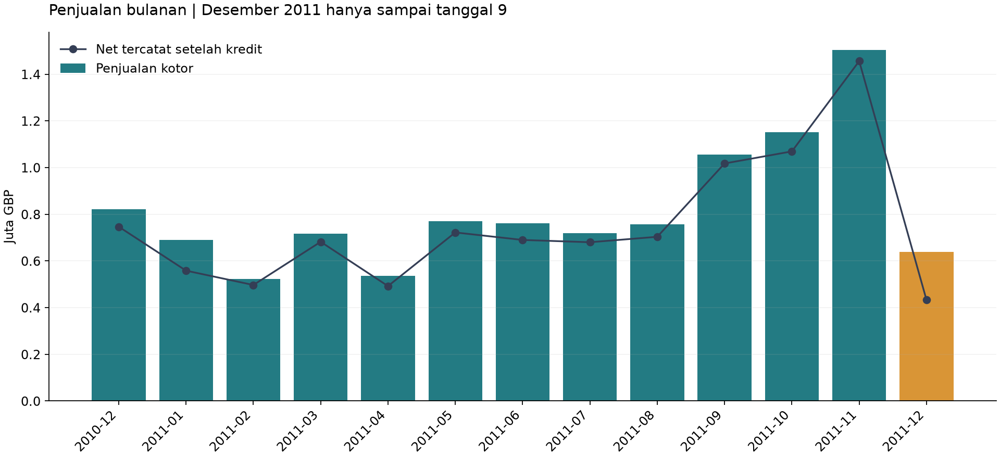
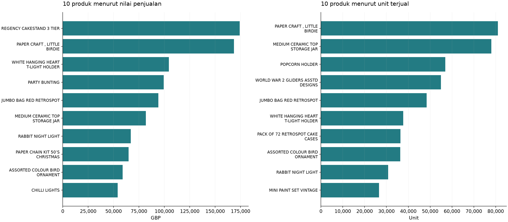
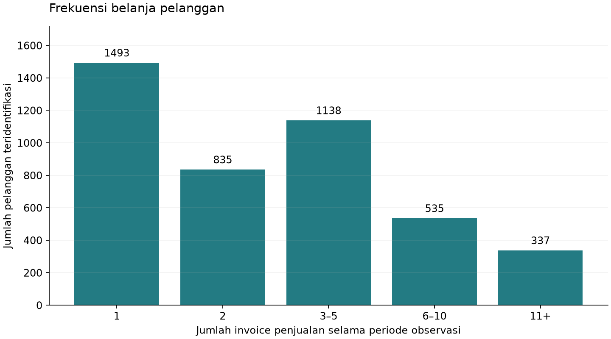

# Analisis penjualan toko online

## Pertanyaan proyek
1. Bagaimana tren nilai penjualan bulanan?
2. Produk mana yang paling laku menurut unit dan nilai penjualan?
3. Bagaimana frekuensi dan nilai belanja pelanggan yang dapat diidentifikasi?

## Data dan definisi
Sumber: [UCI Online Retail](https://archive.ics.uci.edu/dataset/352/online+retail), Daqing Chen (2015), DOI 10.24432/C5BW33, lisensi CC BY 4.0.
Toko berbasis Inggris dengan banyak pelanggan grosir. Rentang: 2010-12-01 08:26:00 sampai 2011-12-09 12:50:00.
Satu baris merupakan item dalam invoice, bukan satu pesanan. Semua nilai uang dalam GBP.
Nilai penjualan kotor (gross) = Quantity × UnitPrice untuk kuantitas dan harga positif, tanpa invoice C.
Nilai ini mencakup tagihan layanan seperti ongkir. Ranking produk hanya memakai kode lima digit dengan akhiran huruf opsional.
Kredit tercatat = nilai absolut baris berkuantitas negatif dengan harga positif. Net tercatat = gross dikurangi kredit tersebut.
Kredit tidak dicocokkan dengan invoice asal. Net ini bukan laba atau ukuran akuntansi audited.
Rata-rata pesanan (AOV) = gross / jumlah invoice penjualan unik.

## Hasil awal
- Baris sumber: 541,909; duplikat persis: 5,268.
- Baris penjualan setelah aturan pembersihan: 524,878.
- Gross: GBP 10,642,110.80; kredit: GBP 893,979.73; net tercatat: GBP 9,748,131.07.
- Pesanan unik: 19,960; AOV: GBP 533.17.
- Bulan dengan gross tertinggi di antara bulan dengan cakupan penuh: **2011-11**, GBP 1,503,866.78.
- Produk dengan nilai penjualan tertinggi: **REGENCY CAKESTAND 3 TIER** (22423), GBP 174,156.54.
- United Kingdom menyumbang 84.6% dari gross.
- Pelanggan teridentifikasi: 4,338; 65.6% memiliki minimal dua invoice penjualan selama periode observasi.
- Penjualan tanpa CustomerID: GBP 1,754,901.91. Baris ini tetap dihitung untuk analisis penjualan, tetapi dikeluarkan dari analisis pelanggan.

## Visualisasi

Desember 2011 hanya tercakup sampai 9 Desember. Penurunannya tidak dapat disimpulkan sebagai penurunan bisnis satu bulan penuh.

## Keputusan pembersihan dan keterbatasan
- Duplikat persis dihapus sebagai asumsi kerja. Tanpa ID item invoice, sebagian pengulangan mungkin sah. Selisih gross sebelum/sesudah deduplikasi: GBP 24,573.74.
- Deskripsi dan CustomerID kosong tidak diisi dengan nilai buatan. Label produk memakai deskripsi yang paling sering muncul untuk StockCode.
- Harga nol/negatif dan kuantitas nol dikeluarkan dari analisis nilai penjualan. Invoice pembatalan C dan baris kuantitas negatif diperiksa terpisah.
- CustomerID hanya memungkinkan analisis pelanggan yang teridentifikasi. Belanja berulang di sini bukan retensi cohort, churn, atau bukti loyalitas jangka panjang.
- RFM adalah ringkasan recency, frequency, monetary. Tanggal acuan historis: 2011-12-10. Monetary memakai gross, bukan net.
- Satu tahun data tidak cukup untuk membuktikan pola musiman yang konsisten. Grosir, pembelian besar, dan kode layanan dapat memengaruhi ranking serta AOV.
- Tidak ada data biaya atau stok, sehingga profitabilitas dan kebutuhan persediaan belum dapat dihitung.
- Ranking produk dan RFM memakai penjualan kotor. Pesanan yang kemudian dibatalkan bisa tetap berkontribusi pada gross. Untuk analisis pembelian yang dipertahankan, perlu pencocokan kredit dengan pesanan asal.

## Tindak lanjut yang didukung analisis
1. Tinjau produk teratas menurut unit dan nilai bersama data stok sebelum menentukan prioritas pengadaan.
2. Telusuri peningkatan penjualan menjelang November dengan membandingkan jumlah pesanan dan AOV. Hubungan dengan promosi atau musim perlu data tambahan.
3. Gunakan tabel RFM untuk mempelajari pelanggan berulang. Evaluasi promosi melalui eksperimen sebelum menyimpulkan dampaknya.

## Belajar berikutnya
Buka notebook dan jalankan sel berurutan. Coba ubah ranking dari nilai penjualan ke unit, lalu jelaskan mengapa hasilnya berbeda.
